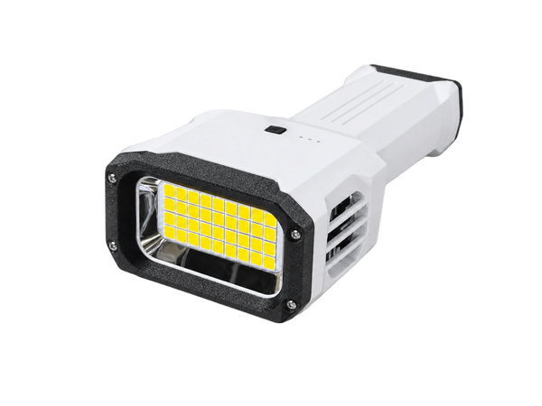
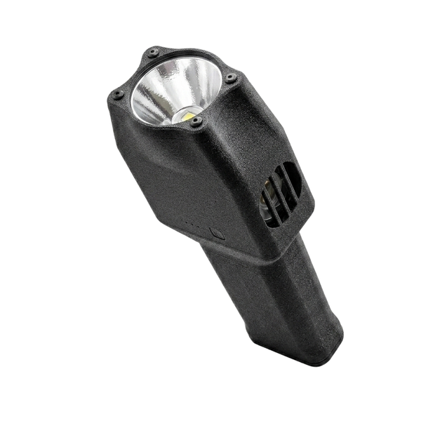
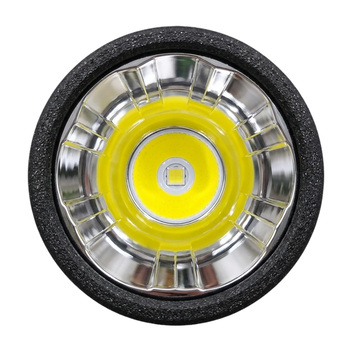

<h1 align="center">ModelYard Hardware</h1>

<p align="center">
  <strong>Hardware files for the Forge series: high-output, actively cooled flashlights you can build, print, flash, and modify for personal, non-commercial use.</strong>
</p>

<p align="center">
  <a href="LICENSE"></a>
  <a href="https://discord.com/users/1088471587927375922"></a>
  <a href="https://github.com/BMHX/modelyard-hardware/releases"></a>
  <a href="https://modelyard.cc"></a>
</p>

Each light has its own folder with a README that lists every file and what it is for. **Forge 60 is the complete package**: PCB fabrication and assembly files, editable source, firmware, print files, and a step-by-step build guide. Start there if you want to build one from scratch.

## Projects

| | Project | Specs | In this repo |
| --- | --- | --- | --- |
|  | **[Forge 60](forge60/README.md)**<br>Standard and Mecha Edition shells | 60 W / about 10,000 lm<br>2S 21700, 45 W USB-C<br>Fan-cooled | **Full build package:** Gerber, BOM, pick-and-place, schematics, EasyEDA Pro source, stencil, firmware, 3MF / STL / Fusion 360, build guide |
|  | **[Forge 500](forge500/README.md)** | 500 W / about 45,000 lm<br>18 V slide-on battery packs<br>Dual-fan, tripod mount | Firmware (RP2040), 3MF / STL / Fusion 360, battery adapters. PCB files on OSHWHub (linked) |
|  | **[Forge 65 / 66](forge65/README.md)** | 65 W / about 7,000 lm<br>2S 21700, 45 W USB-C<br>Forge 66: long-throw lens | Firmware, 3MF / STL (standard, extended handle, 8-cell) |
|  | **[Forge 201](forge201/README.md)** | 200 W / about 30,000 lm<br>4S 21700<br>Fan-cooled | Firmware, 3MF / STL / Fusion 360, reflective-film mold |
| | **[Forge 200](forge200/README.md)**<br>Not sold assembled | | Fusion 360 / STL / 3MF, including a photography-light handle |

### What Each Folder Contains

| Project | PCB files | Firmware | Print files | CAD source | Build guide |
| --- | :---: | :---: | :---: | :---: | :---: |
| [Forge 60](forge60/README.md) | ✅ | ✅ HEX | ✅ | ✅ EasyEDA Pro + Fusion 360 | ✅ |
| [Forge 500](forge500/README.md) | [OSHWHub](https://oshwhub.com/iamdt/guang-chui-500_sc8815_rp2040) | ✅ UF2 | ✅ | ✅ Fusion 360 | [OSHWHub](https://oshwhub.com/iamdt/guang-chui-500_sc8815_rp2040) (Chinese) |
| [Forge 65 / 66](forge65/README.md) | — | ✅ HEX | ✅ | — | — |
| [Forge 201](forge201/README.md) | — | ✅ HEX | ✅ | ✅ Fusion 360 | — |
| [Forge 200](forge200/README.md) | — | — | ✅ | ✅ Fusion 360 | — |

## Firmware

Forge 60, 65, 66, and 201 run **[Forge OS](forge-os/README.md)** on a PY32F003 MCU. That page lists which file to flash for each light, how to flash it, and the button controls. Forge 500 uses its own RP2040 firmware.

All firmware is distributed as compiled HEX / UF2 files. The firmware source code is not published.

## Repository Layout

```text
forge60/     Forge 60: PCB, firmware, print files, source, build guide
forge500/    Forge 500: print files, firmware, add-ons, offline build guide
forge65/     Forge 65 / 66: print files, firmware
forge201/    Forge 201: print files, firmware
forge200/    Forge 200: print files, Fusion 360 source
forge-os/    Forge OS firmware guide (Forge 60 / 65 / 66 / 201)
assets/      Shared icons and product images
```

## Contact

Build questions, mods, and support: message me directly on [Discord](https://discord.com/users/1088471587927375922). Forge 60 demo video: [YouTube](https://www.youtube.com/watch?v=xSCZzmICGlw).

Assembled lights are available at [modelyard.cc](https://modelyard.cc) for anyone who would rather not build one.

## Safety

These are high-power LED and lithium battery projects. Verify polarity, wiring, and the thermal path; current-limit the first power-on; and never downgrade the cells, protection board, wire, or connector specifications. You are responsible for validating your own build.

## License

The files in this repository are licensed under [Creative Commons Attribution-NonCommercial-ShareAlike 4.0](LICENSE) (`CC BY-NC-SA 4.0`).

- **Personal and non-commercial use is free.** You may build, print, flash, modify, and share these designs, as long as you credit ModelYard, do not use them commercially, and share modified versions under the same license.
- **Commercial use requires written permission from ModelYard.** This includes selling lights, kits, PCBs, or printed parts made from these files, and using them in any paid product or service. Without written permission, commercial use is not allowed. For a commercial license, contact [business@modelyard.cc](mailto:business@modelyard.cc).

Forge 500 is based on 光锤500 by iam大头 ([OSHWHub](https://oshwhub.com/iamdt/guang-chui-500_sc8815_rp2040)) and is published here with the author's permission. See [forge500/README.md](forge500/README.md).
