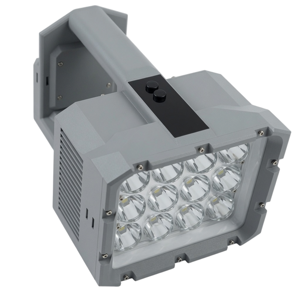

# Forge 500

500 W searchlight with a 12-emitter array, dual-fan cooling, an Arca-compatible tripod mount, and 18 V slide-on power-tool battery packs.

[← All ModelYard hardware projects](../README.md)

  

## Original Design

Forge 500 is based on **光锤500 (Guangchui 500)** by **iam大头**, published on OSHWHub, and is used here with the author's permission:
[oshwhub.com/iamdt/guang-chui-500_sc8815_rp2040](https://oshwhub.com/iamdt/guang-chui-500_sc8815_rp2040)

The PCB design, BOM, and full build guide (Chinese) are on that page. They are not duplicated here.

## At a Glance

| Item | Value |
| --- | --- |
| Output | 500 W / about 45,000 lm |
| Beam | About 1,600,000 cd, up to about 2,500 m |
| LED array | 12 x 3570 emitters, 5700–6000 K, Ra70 |
| Controller | RP2040 MCU, SC8815 power stage |
| Battery | 18 V (5S) slide-on power-tool pack |
| Cooling | Two 50 x 50 x 140 mm heatsinks + two 5010 fans |
| Controls | Stepped output, direct 500 W, direct off, moonlight |
| Housing | PETG-GF main body, PBT lens support |
| Mount | Arca-compatible tripod interface |

## What Is in This Folder

### Print Files

| File | Use |
| --- | --- |
| [mechanical/forge500-3mf.zip](mechanical/forge500-3mf.zip) | Bambu Studio projects: lamp head, handle, top cap, clip, battery adapter and cover, screw-hole positioning jig |
| [mechanical/forge500-stl.zip](mechanical/forge500-stl.zip) | STL files: lamp head, handle, top cap, lens bracket, tail cap and cover plate, screw-hole positioning jig |
| [mechanical/forge500-3mf-petg-gf10-jianji.zip](mechanical/forge500-3mf-petg-gf10-jianji.zip) | 3MF projects tuned for Jianji PETG-GF10 filament |
| [mechanical/forge500-3mf-petg-gf-yubrothers-v2.zip](mechanical/forge500-3mf-petg-gf-yubrothers-v2.zip) | 3MF projects tuned for YuBrothers PETG-GF filament |
| [mechanical/forge500-enclosure.f3z](mechanical/forge500-enclosure.f3z) | Fusion 360 source for the enclosure |

### Add-ons

| File | Use |
| --- | --- |
| [mechanical/add-ons/forge500-a3-battery-adapter-3mf.zip](mechanical/add-ons/forge500-a3-battery-adapter-3mf.zip) | Battery adapter and cover for A3-platform 18 V packs |
| [mechanical/add-ons/forge500-a3-tail-cap-stl.zip](mechanical/add-ons/forge500-a3-tail-cap-stl.zip) | Matching tail cap and cover plate |

### Firmware

RP2040 UF2 files. Put the RP2040 into USB boot mode so it mounts as a drive, then copy one file onto it. The board-specific steps are in the original build guide.

| File | Use |
| --- | --- |
| [firmware/forge500-v1.3-standard.uf2](firmware/forge500-v1.3-standard.uf2) | v1.3, standard power; start here |
| [firmware/forge500-v1.3-minus-10w.uf2](firmware/forge500-v1.3-minus-10w.uf2) | v1.3, power adjusted −10 W |
| [firmware/forge500-v1.3-minus-20w.uf2](firmware/forge500-v1.3-minus-20w.uf2) | v1.3, power adjusted −20 W |
| [firmware/forge500-v1.3-minus-30w.uf2](firmware/forge500-v1.3-minus-30w.uf2) | v1.3, power adjusted −30 W |

The firmware is distributed as compiled UF2 files only.

### Offline Build Guide

[docs/forge500-oshwhub-page-zh.mhtml](docs/forge500-oshwhub-page-zh.mhtml) is a saved copy of the original OSHWHub page (Chinese), for readers who cannot reach the site. GitHub cannot preview `.mhtml` files: download it and open it in Chrome or Edge.

## Buy Assembled

[modelyard.cc/products/forge-500](https://modelyard.cc/products/forge-500)

## Safety

At 500 W this light pulls very high current from the battery pack and gets hot. Use a high-drain 18 V pack in good condition, keep the fans unobstructed, and never point it at people or vehicles.

## License

With the original author's permission, the files in this folder are licensed under CC BY-NC-SA 4.0 like the rest of this repository. Commercial use requires written permission; see [License](../README.md#license). Material on the OSHWHub page itself remains under the license stated there.
