<h1 align="center">Forge 60</h1>

<p align="center">
  <strong>60 W / 10,000 lm flashlight with USB-C power, active cooling, and full manufacturing files.</strong>
</p>

<p align="center">
  <a href="https://www.youtube.com/watch?v=xSCZzmICGlw"></a>
  <a href="https://modelyard.cc/products/forge-60"></a>
  <a href="https://discord.com/users/1088471587927375922"></a>
  <a href="https://github.com/BMHX/modelyard-hardware/releases"></a>
</p>

<p align="center">
  <a href="LICENSE"></a>
  <a href="#hardware-downloads"></a>
  <a href="#source-project"></a>
</p>

<p align="center">
  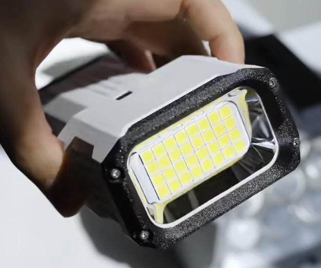
</p>

<p align="center"><a href="../README.md">← All ModelYard hardware projects</a></p>

Forge 60 is a reproducible flashlight platform built around a constant 60 W / 10,000 lm output mode, a high-current driver board, a 5050 LED board, active cooling, and a USB-C charge/discharge power path. This folder includes fabrication files, assembly data, schematics, and editable EasyEDA Pro source files so builders can manufacture, inspect, modify, and assemble the project.

## Quick Links

| Action | Link |
| --- | --- |
|  Watch demo | [YouTube video](https://www.youtube.com/watch?v=xSCZzmICGlw) |
|  Buy assembled | [ModelYard Forge 60](https://modelyard.cc/products/forge-60) |
|  Contact me | [Discord](https://discord.com/users/1088471587927375922) |
|  Download release | [GitHub Releases](https://github.com/BMHX/modelyard-hardware/releases) |
|  Download hardware files | [Hardware Downloads](#hardware-downloads) |
|  Download firmware | [Forge 60 OS v1.2 HEX](firmware/forge60-os-v1.2.hex) |
|  Download mechanical model | [Forge 60 v10 3MF](mechanical/forge60-v10.3mf) |
|  Download Mecha Edition shell | [Mecha Edition](#mecha-edition-shell) |
|  Edit source project | [EasyEDA Pro source](source/forge60-easyeda-pro-source.epro2) |

## At a Glance

| Item | Value |
| --- | --- |
| Output | 60 W / about 10,000 lm |
| USB-C power | About 45 W charging / discharging |
| Battery architecture | 2S 21700 lithium battery pack |
| Cooling | 30 x 30 x 50 mm heatsink + 3010 fan |
| Recommended hardware files | Mainboard v2 + 5050 LED board |
| Mainboard | 4 layers, 1.0 mm |
| LED board | 1.6 mm |
| Firmware | Forge 60 OS v1.2 HEX (binary only) |
| Mechanical model | Forge 60 v10 3MF, plus the Mecha Edition shell |
| Source format | EasyEDA Pro `.epro2` |
| License | CC BY-NC-SA 4.0 (commercial use requires written permission) |

## Important Notes

- **Recommended board:** use `mainboard-v2`. Older mainboard revisions are not recommended for new builds.
- **PCB thickness matters:** order the mainboard at **1.0 mm** and the LED board at **1.6 mm**.
- **LED part:** the 5050 LED board is intended for 6 V 5050 emitters. Current builds use Seoul Semiconductor `STW0L8PA`, 5700 K, around CRI 70. The LED BOM does not use an LCSC part number.
- **Firmware is binary only:** the HEX file is provided for flashing; the firmware source code is not published.
- **KiCad is not included yet:** editable source is currently provided as an EasyEDA Pro project.
- **High-power safety:** this project uses high-current lithium cells and a high-power LED. Validate wiring, polarity, thermal path, and firmware before sustained operation.
- **Battery shipping:** if you ship builds with cells, use a logistics channel that supports lithium batteries.

## Contents

- [Demo](#demo)
- [Buy Assembled](#buy-assembled)
- [Performance](#performance)
- [Hardware Downloads](#hardware-downloads)
- [Manufacturing Notes](#manufacturing-notes)
- [Firmware and Mechanical Files](#firmware-and-mechanical-files)
- [Source Project](#source-project)
- [PCB and Schematic Preview](#pcb-and-schematic-preview)
- [BOM Overview](#bom-overview)
- [Build Flow](#build-flow)
- [Required Tools](#required-tools)
- [Firmware Flashing](#firmware-flashing)
- [Assembly Notes](#assembly-notes)
- [Operation](#operation)
- [Contact](#contact)
- [Safety and Disclaimer](#safety-and-disclaimer)
- [Folder Layout](#folder-layout)
- [License](#license)

## Demo

[](https://www.youtube.com/watch?v=xSCZzmICGlw)

Watch the demo: [https://www.youtube.com/watch?v=xSCZzmICGlw](https://www.youtube.com/watch?v=xSCZzmICGlw)

## Buy Assembled

This folder contains the hardware files for builders who want to manufacture or modify the project themselves. If you would rather not build one, a fully assembled Forge 60 is available separately:

[](https://modelyard.cc/products/forge-60)

Direct link: [https://modelyard.cc/products/forge-60](https://modelyard.cc/products/forge-60)

## Performance

| Mode | Runtime |
| --- | --- |
| 60 W | About 27 minutes |
| 30 W | About 54 minutes |
| 3 W | About 8 hours |

These are reference values from the project build. Final performance depends on LED bin, cell condition, protection board, wiring resistance, cooling quality, firmware, and assembly.

## Hardware Downloads

Gerber files are for PCB fabrication. BOM files are for sourcing. Pick-and-place files are for SMT assembly. Schematic and PCB preview files are provided for review.

| Board | Gerber | BOM | Pick and Place | Schematic | PCB Preview |
| --- | --- | --- | --- | --- | --- |
| Mainboard v2 | [ZIP](mainboard-v2/mainboard-v2-gerber.zip) | [XLSX](mainboard-v2/mainboard-v2-bom.xlsx) / [CSV](mainboard-v2/mainboard-v2-bom.csv) | [XLSX](mainboard-v2/mainboard-v2-pick-and-place.xlsx) / [CSV](mainboard-v2/mainboard-v2-pick-and-place.csv) | [PDF](mainboard-v2/mainboard-v2-schematic.pdf) | [PDF](mainboard-v2/mainboard-v2-pcb-preview.pdf) |
| 5050 LED Board | [ZIP](led-board-5050/led-board-5050-gerber.zip) | [XLSX](led-board-5050/led-board-5050-bom.xlsx) / [CSV](led-board-5050/led-board-5050-bom.csv) | [XLSX](led-board-5050/led-board-5050-pick-and-place.xlsx) / [CSV](led-board-5050/led-board-5050-pick-and-place.csv) | [PDF](led-board-5050/led-board-5050-schematic.pdf) | [PDF](led-board-5050/led-board-5050-pcb-preview.pdf) |

A solder paste stencil outline for the mainboard is provided as [stencil/forge60-mainboard-v2-stencil.dxf](stencil/forge60-mainboard-v2-stencil.dxf).

## Manufacturing Notes

- Mainboard v2: order as a **4-layer, 1.0 mm** PCB.
- 5050 LED board: order as **1.6 mm** PCB.
- Use the Gerber zip, BOM, and pick-and-place files from the same board folder.
- The BOM files are the source of truth for electronic components; verify substitutes before assembly.
- The LED board BOM intentionally leaves the LED supplier part number blank because the LED is not an LCSC part. Do not substitute the LED row with an 0805 indicator LED.
- If outsourcing SMT, provide the manufacturer with Gerber, BOM, and pick-and-place files together.
- Before ordering, confirm board stack-up, substrate, copper weight, and surface finish with the PCB manufacturer.

## Firmware and Mechanical Files

| File | Link | Use |
| --- | --- | --- |
| Forge 60 OS v1.2 firmware | [forge60-os-v1.2.hex](firmware/forge60-os-v1.2.hex) | Flash the PY32F003xx6 mainboard MCU |
| Forge 60 v10 mechanical model | [forge60-v10.3mf](mechanical/forge60-v10.3mf) | Bambu Studio project for the standard shell, including the reflective-film mold and glass-cutting jig |

### Mecha Edition Shell

An alternative shell for the same electronics, in [mechanical/mecha-edition](mechanical/mecha-edition).

| File | Use |
| --- | --- |
| [forge60-mecha-edition.f3d](mechanical/mecha-edition/forge60-mecha-edition.f3d) | Fusion 360 source |
| [forge60-mecha-edition-stl.zip](mechanical/mecha-edition/forge60-mecha-edition-stl.zip) | STL files: handle, lamp head, top cap, tail cap, button |
| [forge60-mecha-edition-3mf-petg-gf-tianrui.zip](mechanical/mecha-edition/forge60-mecha-edition-3mf-petg-gf-tianrui.zip) | Bambu Studio 3MF projects tuned for Tianrui PETG-GF filament |
| [forge60-mecha-edition-handle-extended-70mm.stl](mechanical/mecha-edition/forge60-mecha-edition-handle-extended-70mm.stl) | Handle extended by 70 mm |

## Source Project

| Format | Download |
| --- | --- |
| EasyEDA Pro source | [forge60-easyeda-pro-source.epro2](source/forge60-easyeda-pro-source.epro2) |

The editable project is currently provided in EasyEDA Pro format. KiCad files are not included in this release.

## PCB and Schematic Preview

### PCB Preview

| Mainboard v2 | 5050 LED Board |
| --- | --- |
| 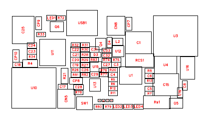 | 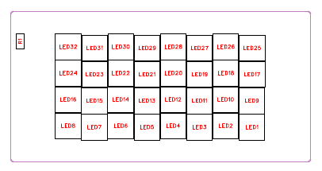 |

### Schematic Preview

| Mainboard v2 | 5050 LED Board |
| --- | --- |
| 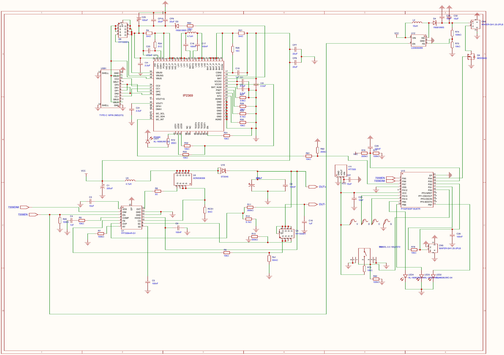 | 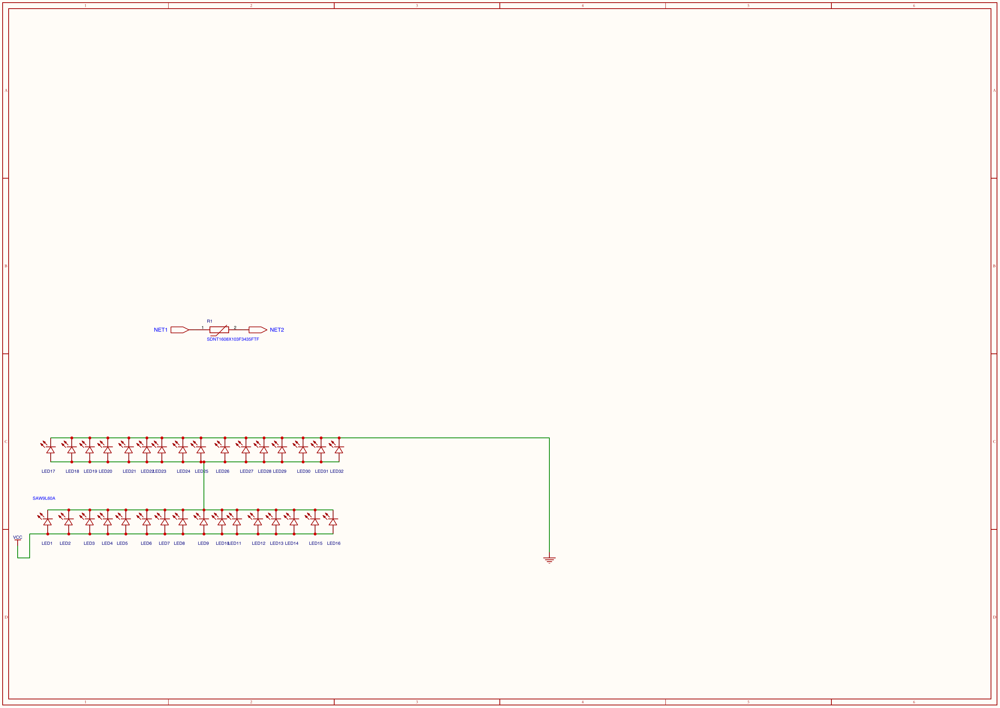 |

## BOM Overview

The full BOM is provided in the hardware download table. Major parts include:

- IP2369 charge/discharge controller
- FP7209 LED driver controller
- PY32F003 series MCU
- Seoul Semiconductor STW0L8PA 6 V 5050 LEDs, 5700 K, around CRI 70
- 2S protection board, 13 A class recommended
- High-drain 21700 cells, such as JP40 / 40PL / 45D class cells
- 30 x 30 x 50 mm heatsink
- 3010 cooling fan
- 74 mm protective glass
- XT30 male/female connectors
- GH1.25 2P cables
- 20 AWG and 16 AWG flexible silicone wires
- M1.4 and M1.7 heat-set inserts
- Reflective film, thermal tape, thermal grease, shock-absorbing foam, and high-temperature tape

## Build Flow

1. Review the schematic PDFs and PCB previews.
2. Order the mainboard and LED board using the Gerber files and thickness notes.
3. Source components from the BOM.
4. Use pick-and-place files for SMT assembly where applicable.
5. Print or prepare the mechanical parts and cooling stack.
6. Flash the mainboard firmware.
7. Assemble wiring, LED board, fan, battery pack, and enclosure.
8. Perform current-limited first power-on testing and monitor temperature.

## Required Tools

- 3D printer
- Spot welder
- Hot plate or hot air station
- Soldering iron
- PWLINK2 LITE programmer
- 1.25 mm programming probe
- Glass cutter, if cutting the protective glass manually
- H1.3 / H1.5 hex drivers

## Firmware Flashing

Use PWLINK2 LITE and select the PY32F003xx6 series target in the programming software. Pay close attention to the V and G pads on the mainboard. Reversed programming probe wiring can damage the board.

| Select MCU | Add firmware | Apply firmware |
| --- | --- | --- |
| 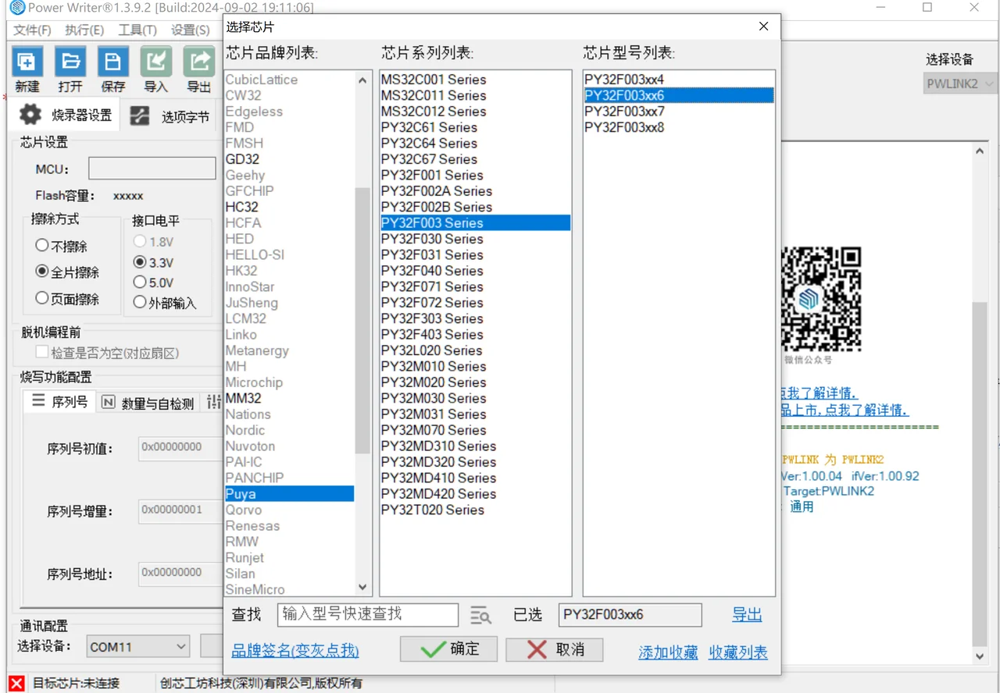 | 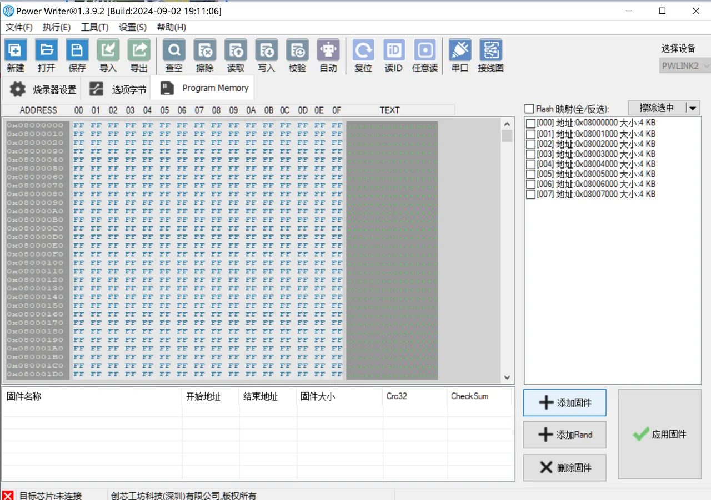 | 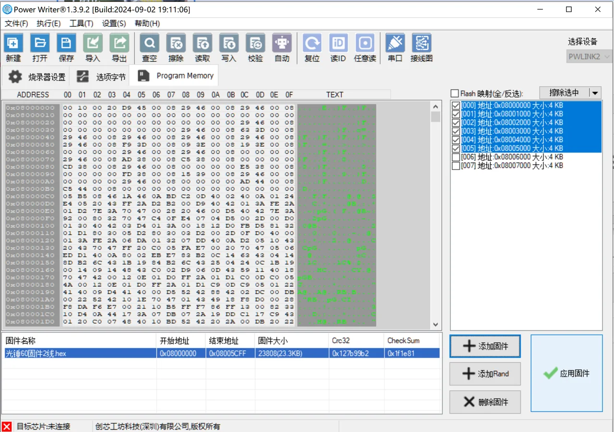 |

| Probe wiring | Mainboard pads | Program complete |
| --- | --- | --- |
| 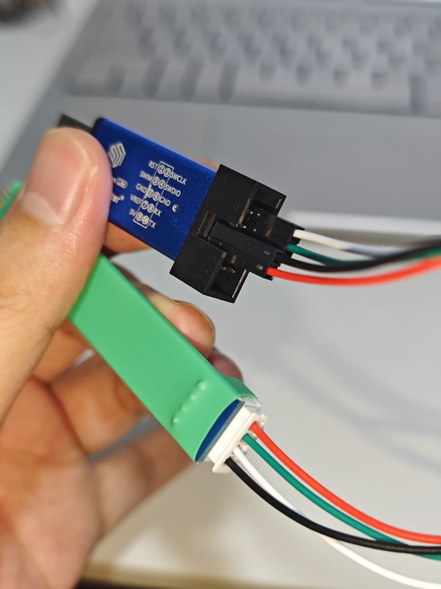 | 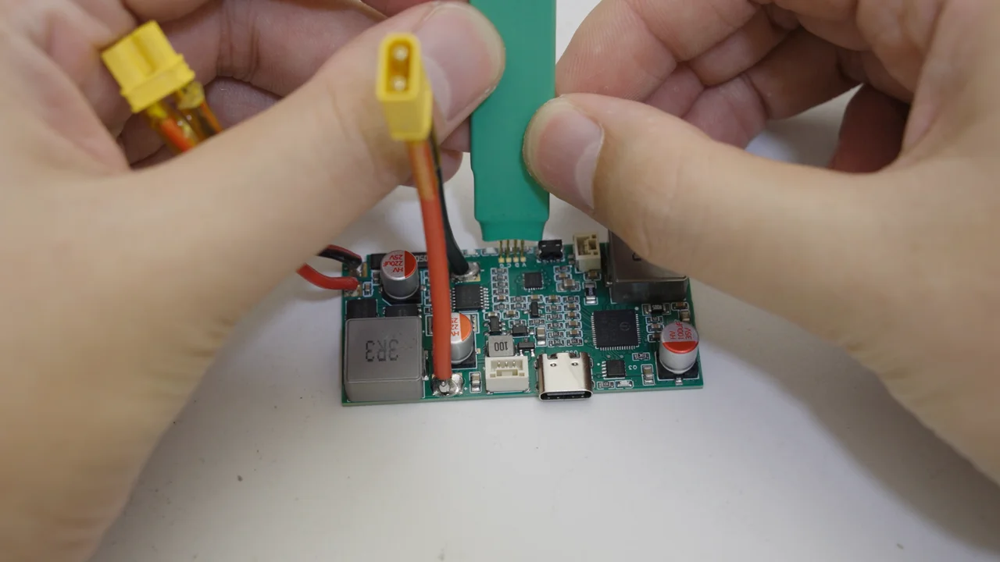 | 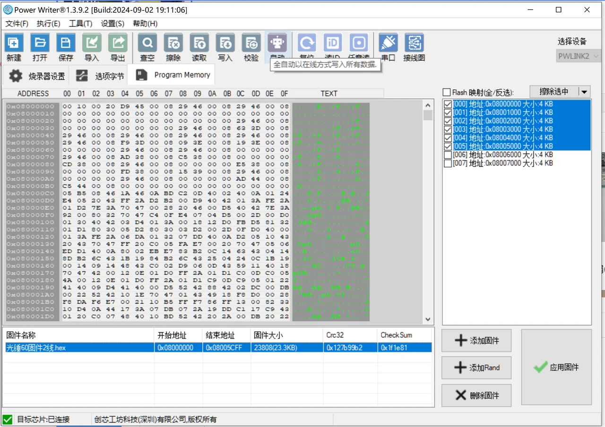 |

## Assembly Notes

1. Flash the mainboard firmware before final assembly.
2. Use 16 AWG silicone wire for the mainboard input and XT30 male connector.
3. Use 20 AWG silicone wire and GH1.25 2P cables on the LED board side.
4. Mount the 3010 fan to the heatsink, then modify the fan lead to GH1.25 2P if needed.
5. Connect the mainboard output, LED board input, temperature sensing line, and fan line before closing the structure.
6. Use M1.7 heat-set inserts for the lamp-head top cover and M1.4 heat-set inserts for the handle connection.
7. Center the protection board inside the handle battery pack.
8. Add foam around the battery pack output side to reduce vibration and compression risk.

| Mainboard input wiring | Fan installation | Fan connector modification |
| --- | --- | --- |
| 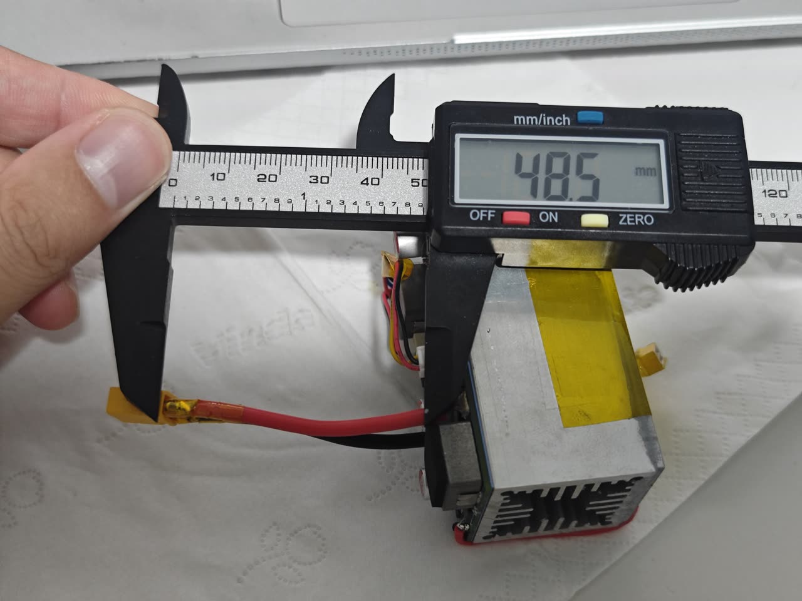 | 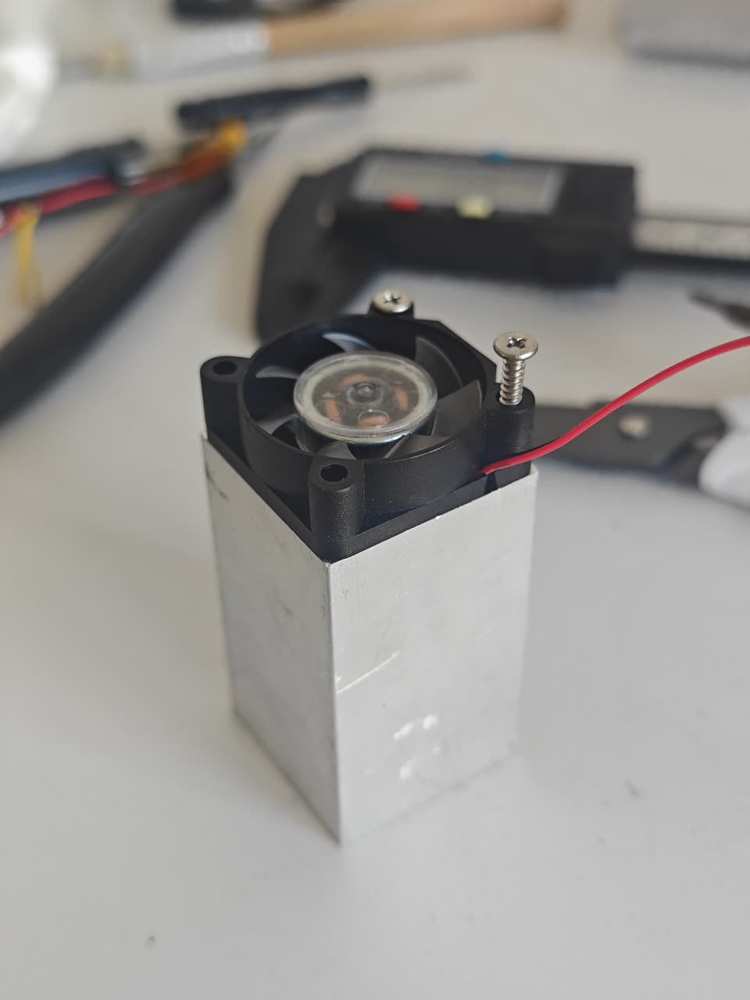 | 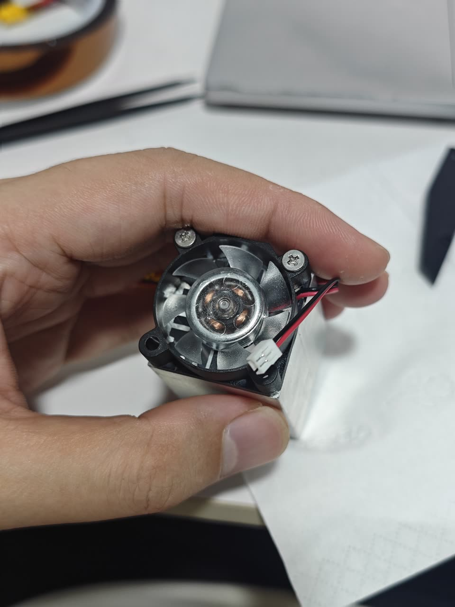 |

| Mainboard and LED board wiring | Battery pack installation |
| --- | --- |
| 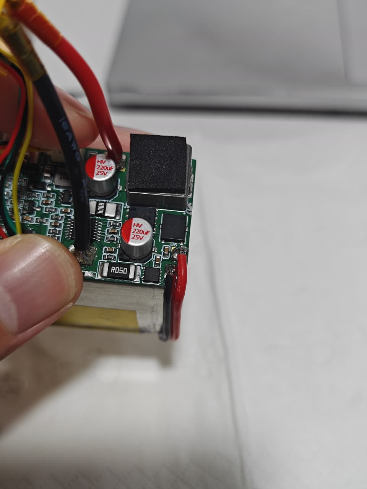 | 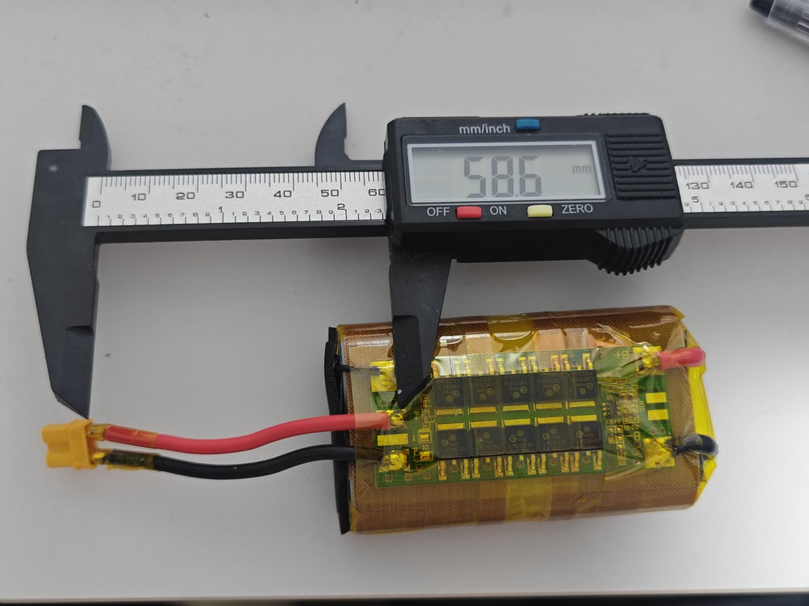 |

## Operation

Forge 60 runs Forge OS. The full button reference is in [Forge OS](../forge-os/README.md).

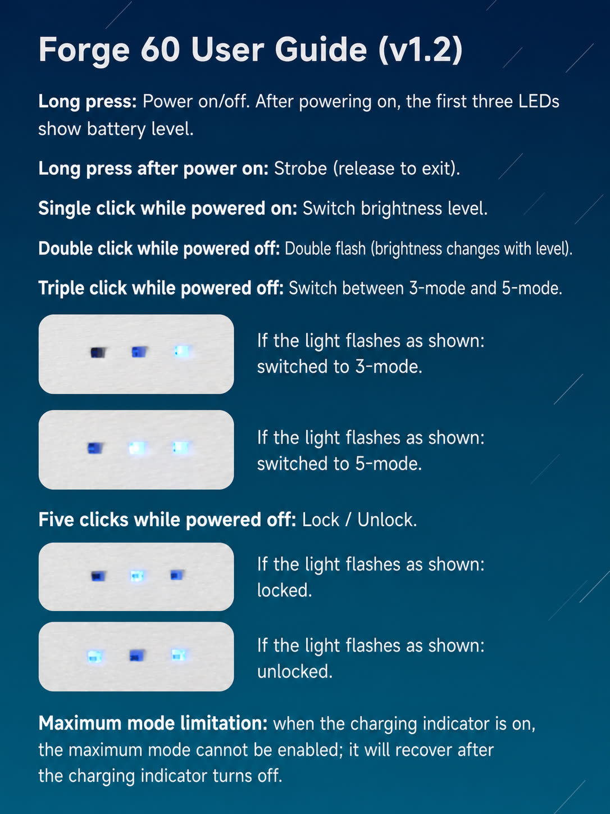

## Contact

For build questions, support, and modification ideas, message me directly:

[](https://discord.com/users/1088471587927375922)

Direct link: [https://discord.com/users/1088471587927375922](https://discord.com/users/1088471587927375922)

## Safety and Disclaimer

This is a high-power LED and lithium battery project. Build and test it carefully.

- Do not downgrade protection board, cell, wire, or connector specifications.
- Verify the thermal path before sustained high-power operation.
- Check polarity and programming probe orientation before flashing.
- Current-limit the first power-on test and monitor temperature.
- Do not leave the battery pack or high-power LED unattended during early testing.
- If shipping batteries internationally, use a logistics channel that supports lithium batteries.
- You are responsible for validating the design, assembly, firmware, battery pack, and thermal behavior before use.

## Folder Layout

```text
forge60/
  firmware/
    forge60-os-v1.2.hex
  mainboard-v2/
    mainboard-v2-gerber.zip
    mainboard-v2-bom.xlsx / .csv
    mainboard-v2-pick-and-place.xlsx / .csv
    mainboard-v2-schematic.pdf
    mainboard-v2-pcb-preview.pdf
  led-board-5050/
    led-board-5050-gerber.zip
    led-board-5050-bom.xlsx / .csv
    led-board-5050-pick-and-place.xlsx / .csv
    led-board-5050-schematic.pdf
    led-board-5050-pcb-preview.pdf
  stencil/
    forge60-mainboard-v2-stencil.dxf
  mechanical/
    forge60-v10.3mf
    mecha-edition/
  source/
    forge60-easyeda-pro-source.epro2
  docs/
    file-checklist.md
  assets/
    images, build photos, PCB and schematic previews used by this README
```

## License

Forge 60 is licensed under [Creative Commons Attribution-NonCommercial-ShareAlike 4.0](LICENSE) (`CC BY-NC-SA 4.0`). Personal and non-commercial use is free. Commercial use, including selling lights, kits, PCBs, or printed parts made from these files, requires written permission from ModelYard; contact [business@modelyard.cc](mailto:business@modelyard.cc).
