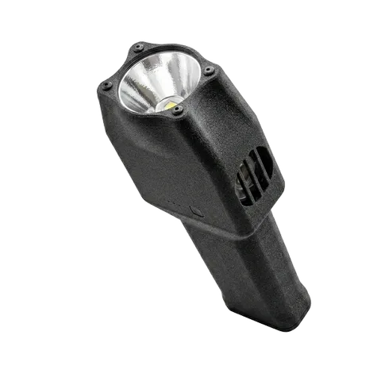
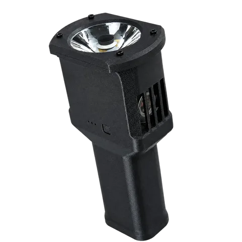

# Forge 65 / Forge 66

Compact 65 W / about 7,000 lm flashlights with active cooling, 45 W USB-C charge/discharge, and a 2S 21700 battery pack. Forge 66 is the long-throw version, with a 50 mm lens and about 190,000 cd.

[← All ModelYard hardware projects](../README.md)

| Forge 65 | Forge 66 |
| --- | --- |
|  |  |

## At a Glance

| Item | Forge 65 | Forge 66 |
| --- | --- | --- |
| Output | 65 W / about 7,000 lm | 65 W / about 7,000 lm |
| Beam intensity | About 120,000 cd | About 190,000 cd, up to about 870 m |
| Optics | 42 x 32 x 10 mm orange-peel reflector | 50 mm lens |
| LED | 12 V SFQ75, 5500 K, on a thermally separated copper substrate | 5500 K |
| USB-C power | 45 W charge / discharge | 45 W charge / discharge |
| Battery | 2S 21700 pack | 2S 21700 pack |
| Cooling | 30 x 30 x 50 mm heatsink + 3010 fan | 30 x 30 x 50 mm heatsink + 3010 fan |
| Runtime | About 24 min at 65 W, 54 min at 30 W, 8 h at 3 W | Same |

## What Is in This Folder

| File | Use |
| --- | --- |
| [mechanical/forge65-v1.3mf](mechanical/forge65-v1.3mf) | Bambu Studio project: handle, lamp head, top cap, button, tail cap |
| [mechanical/forge65-v1-handle-extended.3mf](mechanical/forge65-v1-handle-extended.3mf) | Bambu Studio project with the extended handle |
| [mechanical/forge65-stl.zip](mechanical/forge65-stl.zip) | STL files for the standard shell (the tail cap is shared with Forge 60) |
| [mechanical/forge65-8-cell-stl.zip](mechanical/forge65-8-cell-stl.zip) | STL files for the 8-cell variant: lamp head, barrel, bottom cap, top cap, button |
| [firmware/forge-os-forge65-66-v1.2.2-standard.hex](firmware/forge-os-forge65-66-v1.2.2-standard.hex) | Forge OS v1.2.2 for Forge 65 and Forge 66 |
| [firmware/forge-os-forge65-66-v1.2.2-fine-tune-minus-2.hex](firmware/forge-os-forge65-66-v1.2.2-fine-tune-minus-2.hex) | Same, with power fine-tune −2 |

Flashing and button operation: see [Forge OS](../forge-os/README.md).

**Not included yet:** PCB files for Forge 65 / 66 and the Forge 66 shell files.

## Buy Assembled

- Forge 65: [modelyard.cc/products/forge-65](https://modelyard.cc/products/forge-65)
- Forge 66: [modelyard.cc/products/forge-66](https://modelyard.cc/products/forge-66)

## Safety

This is a high-power LED and lithium battery project. Use a built 2S pack with a protection board, current-limit the first power-on, and monitor temperature.

## License

CC BY-NC-SA 4.0. Commercial use requires written permission; see [License](../README.md#license).
